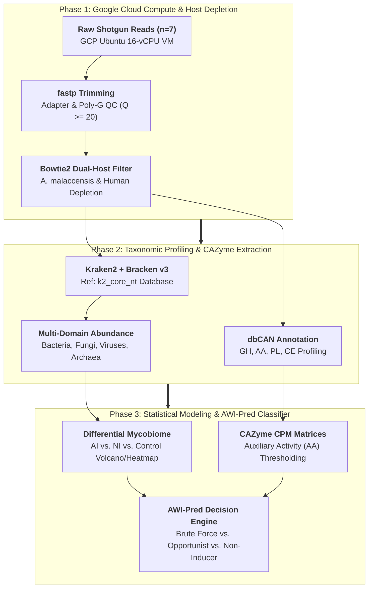
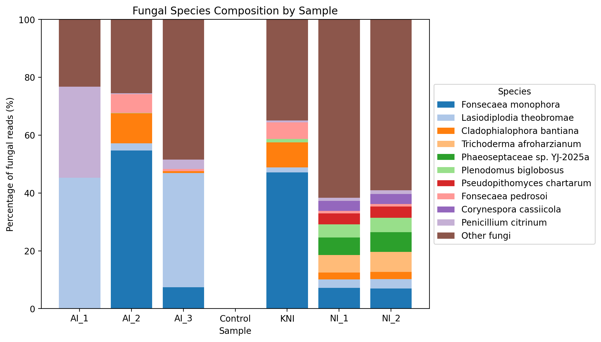
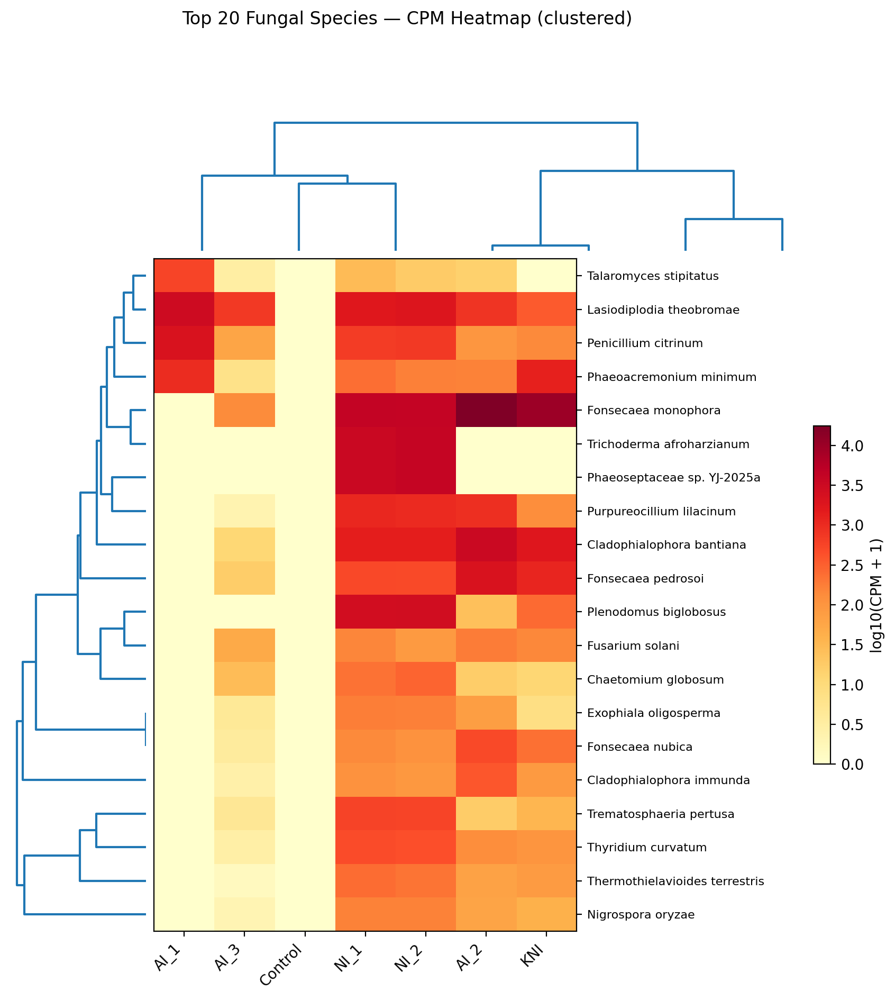
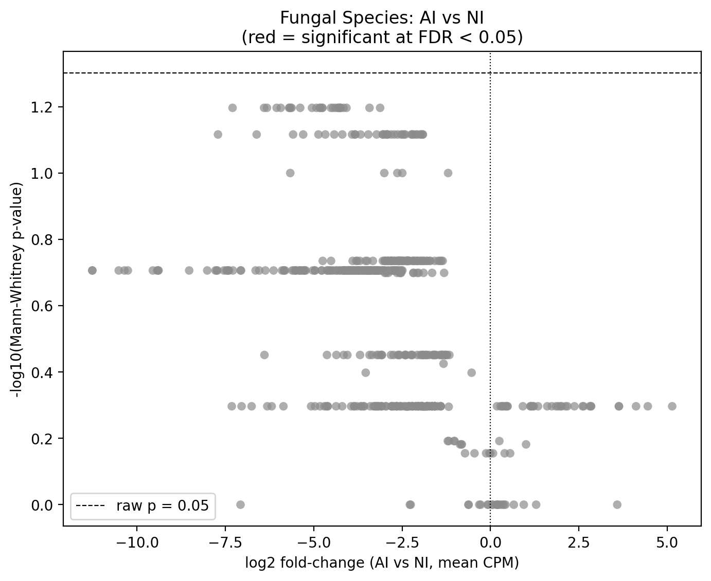
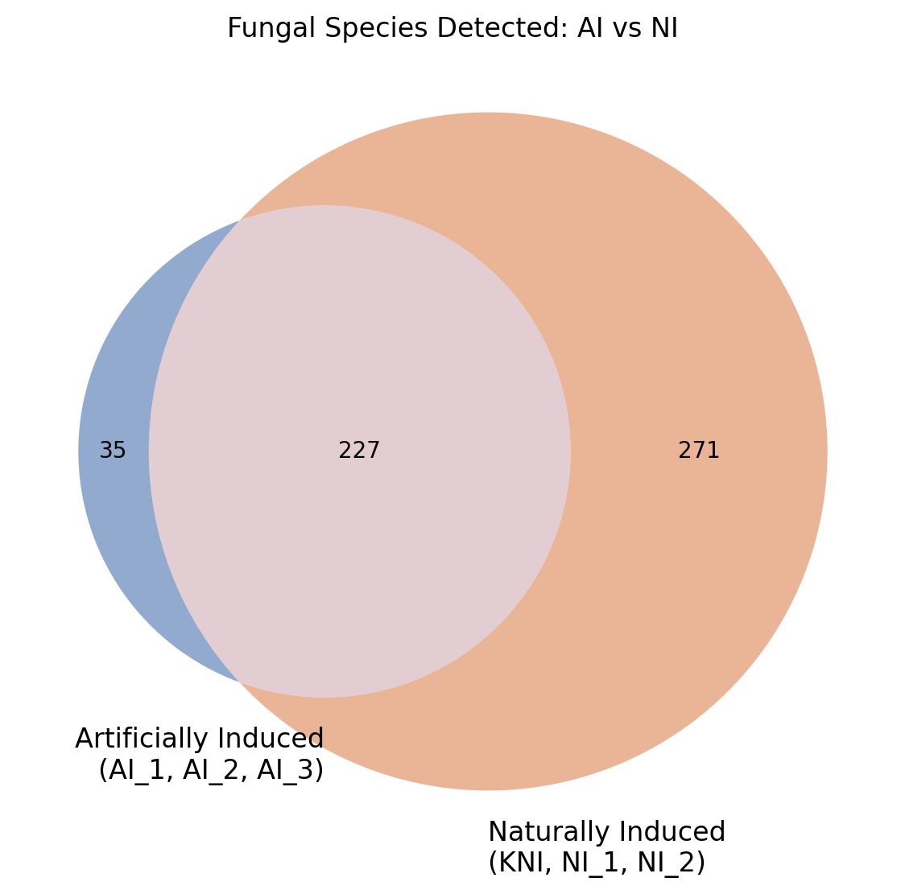
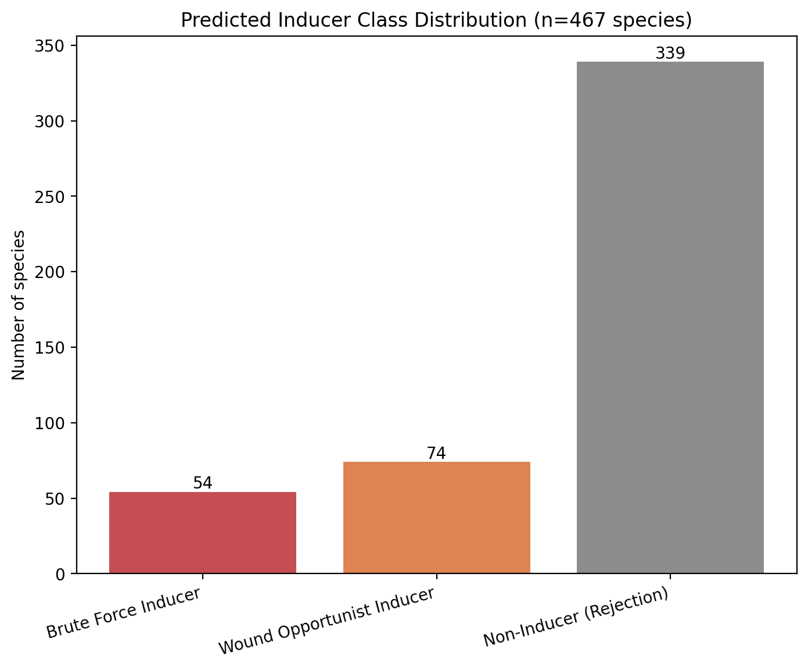
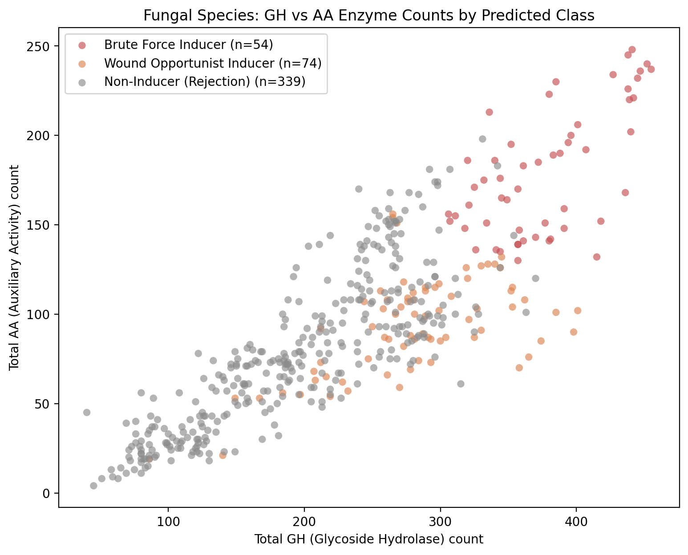
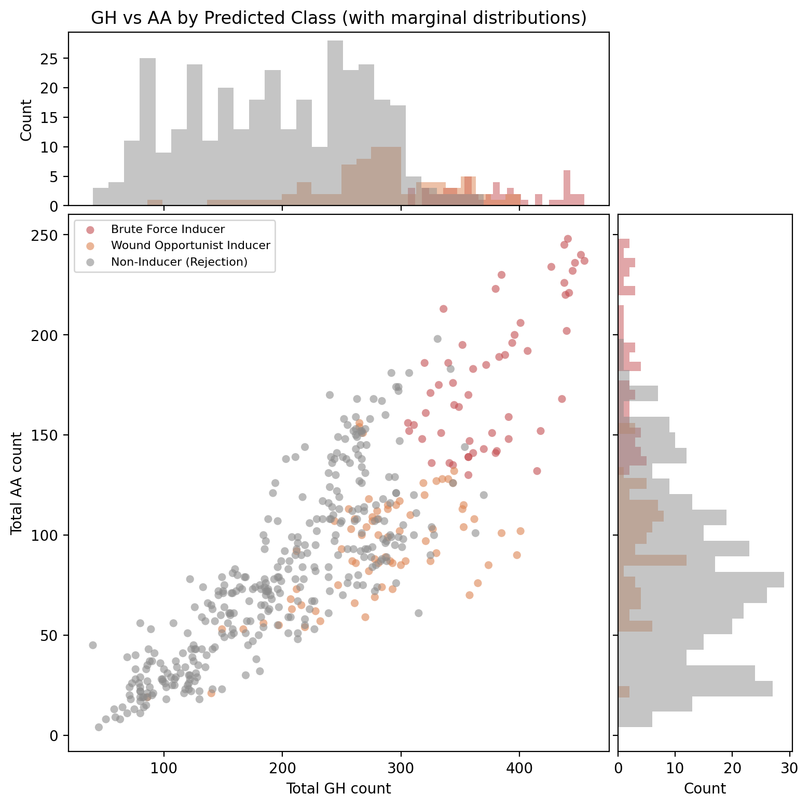
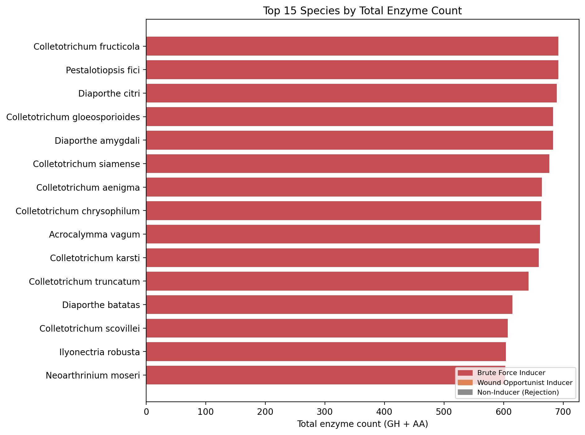

# Shotgun Metagenomic Dissection of the *Aquilaria malaccensis* Microbiome: Fungal Community Dynamics, CAZyme Architectures, and Predictive Modeling of Agarwood Induction

**Author(s):** Tanbir Rahman, Jobayer Hossain Rafi, Md Abu Sadat Soash  
*Department of Genetic Engineering and Biotechnology*<br>
*Shahjalal University of Science and Technology, Sylhet, Bangladesh*

[](#confidentiality--academic-evaluation-notice)
[](https://www.ncbi.nlm.nih.gov/datasets/taxonomy/181630/)
[](cloud_pipeline/)
[](scripts/)
[](awi_pred/)

---

## Confidentiality & Academic Evaluation Notice

> **Important Notice:** This repository contains **unpublished research and ongoing manuscript preparations** by Tanbir Rahman, Jobayer Hossain Rafi, and Md Abu Sadat Soash. 
> - **Author Contributions:** Wet-lab sample isolation, field inoculation experiments, and manuscript writing were conducted by **Tanbir Rahman** and **Jobayer Hossain Rafi**. Large-scale bioinformatic workflows, Google Cloud Platform (GCP) Ubuntu compute infrastructure, taxonomic classification, CAZyme profiling, and the **AWI-Pred** machine learning/rule-based decision model were conceived, developed, and executed by **Md Abu Sadat Soash**.
> - **Purpose:** This repository serves as a verifiable, documented record of computational methodologies, analytical workflows, and reproducible scripts for prospective academic review and graduate research evaluation.
> - **Data Protection:** Raw high-throughput FASTQ sequencing data, proprietary biological isolate records, and unpublished manuscript drafts are restricted and excluded via `.gitignore` to maintain confidentiality prior to formal peer-reviewed publication.

---

## Abstract

* **Objective:** Agarwood, a fragrant resinous heartwood derived from *Aquilaria* species (notably *Aquilaria malaccensis*), is an economically prized botanical commodity driven by defensive plant sesquiterpenoid and 2-(2-phenylethyl)chromone secondary metabolite synthesis. Wild agarwood formation is triggered by physical injury and opportunistic microbial infection. However, the exact taxonomic community shifts and enzymatic mechanisms distinguishing artificial chemical/fungal inoculation (AI) from natural resinous induction (NI) remain poorly understood. This study aims to decipher the *A. malaccensis* metagenome across distinct induction modalities and develop a predictive bioinformatic classifier to identify prospective agarwood-inducing fungal species.
* **Methodology:** Shotgun metagenomic sequencing was performed across 7 biological conditions spanning Artificial Inoculation (`AI_1`, `AI_2`, `AI_3`), Natural Induction (`NI_1`, `NI_2`), Knotted Physical Wounding (`KNI`), and non-induced healthy controls (`Control`). Raw reads were processed on a Google Cloud Platform (GCP) 16-vCPU Ubuntu instance, undergoing adapter/poly-G trimming (`fastp`) and dual-host decontamination (`bowtie2`) against *Aquilaria malaccensis* (`GCA_037177235.1`) and human contaminant reference genomes. Pure microbial reads were classified across all four domains using **Kraken2** and abundance-corrected via **Bracken v3.0.1** using the comprehensive `k2_core_nt` database. Fungal Carbohydrate-Active enZymes (CAZymes) were mined using **dbCAN**, and an empirical rule-based decision tree (**AWI-Pred**) was formulated to classify fungal genomes based on auxiliary activity (AA) and glycoside hydrolase (GH) arsenals.
* **Findings:** Host depletion successfully isolated microbial read fractions, revealing significant taxonomic succession in the fungal mycobiome. Artificially induced trees (AI) exhibited a profound restructuring of dominant fungal endophytes and pathogens relative to non-induced controls. CAZyme profiling established that verified agarwood-inducing fungi possess specialized wood-penetration signatures. The **AWI-Pred** decision framework segregated candidate fungi into two primary functional categories: **"Brute Force" Inducers** (possessing high Auxiliary Activities $\text{AA} \ge 130$, Glycoside Hydrolases $\text{GH} \ge 300$, and Tier 1 structural lignin/cellulose clusters) versus **"Wound Opportunists"** (low structural firepower, relying on Tier 2 pectin/sap metabolism). Benchmarking against confirmed inducers (*Colletotrichum gloeosporioides*, *Fusarium oxysporum*, *Botryosphaeria dothidea*, *Lasiodiplodia theobromae*) confirmed robust model fidelity across 533 evaluated fungal proteomes.
* **Implications:** This study provides a comprehensive metagenomic and enzymatic blueprint of microbial agarwood formation. The AWI-Pred computational framework provides a high-throughput screening tool to select non-destructive, highly potent fungal bio-inoculants, replacing destructive tree harvesting with sustainable biotechnology.

---

## 1. Biological Background & Motivation

*Aquilaria malaccensis* (Thymelaeaceae) is an endangered evergreen tree native to South and Southeast Asia. Healthy *Aquilaria* wood is pale, soft, and devoid of fragrance. In response to fungal invasion, insect infestation, or physical wounding, the tree mounts a systemic defense reaction, producing heavy, dark resin saturated with aromatic sesquiterpenoids and phenylethyl chromones.

```
                    Aquilaria malaccensis Trunk
                                 │
                 ┌───────────────┴───────────────┐
                 ▼                               ▼
       Mechanical Wounding /             Opportunistic Fungal
      Physical Damage (KNI)             Inoculation (AI & NI)
                 │                               │
                 ▼                               ▼
       Parenchyma Exposure &           Lignocellulolytic Attack
      Cell Wall Stress Signals         (CAZymes: GH & AA Families)
                 │                               │
                 └───────────────┬───────────────┘
                                 ▼
                     Plant Defense Activation:
                   • Sesquiterpene Synthases
                   • Phenylpropanoid Cascade
                                 │
                 ┌───────────────┴───────────────┐
                 ▼                               ▼
        Pathway A: Brute Force          Pathway B: Opportunist
       Lignin Armor Breakdown          Parenchyma Sap Parasitism
      (AA >= 130, GH >= 300)            (Tier 2 Pectin / Starch)
                 │                               │
                 └───────────────┬───────────────┘
                                 ▼
              Dense Resinous Agarwood Heartwood Deposition
```

1. **The Inoculation Bottleneck:** Natural agarwood occurs in fewer than 10% of mature wild trees, taking decades to accumulate. Artificial fungal inoculation has emerged as a sustainable commercial alternative. However, wet-lab screening of candidate fungi is labor-intensive, taking months of field incubation per strain.
2. **The Metagenomic Perspective:** Shotgun metagenomic sequencing directly captures the active endophytic and rhizosphere microbial consortium without cultivation bias, revealing which fungal taxa correlate with successful resin accumulation.
3. **The CAZyme Hypothesis:** We hypothesized that a fungus's capacity to induce agarwood is dictated by its Carbohydrate-Active Enzyme (CAZyme) repertoire—specifically whether it possesses the oxidative enzymes (Auxiliary Activities, AAs) necessary to breach dense lignin armor without structurally decomposing the entire trunk.

---

## 2. Metagenomic Dataset & Treatment Cohorts

Shotgun metagenomic libraries were generated across seven experimental conditions to capture distinct stages and modes of agarwood induction in *Aquilaria malaccensis*:

| Sample Identifier | Experimental Group / Treatment | Biological Description | Sequencing Protocol |
| :--- | :--- | :--- | :--- |
| **`AI_1`** | Artificial Inoculation (Replicate 1) | Chemically/biologically inoculated trunk wood showing resin lines | Illumina PE150 |
| **`AI_2`** | Artificial Inoculation (Replicate 2) | Actively induced resinous heartwood zone | Illumina PE100 |
| **`AI_3`** | Artificial Inoculation (Replicate 3) | Hyper-induced heartwood sample | Illumina PE150 |
| **`NI_1`** | Natural Induction (Replicate 1) | Naturally infected forest specimen with wild resin formation | Illumina PE100 |
| **`NI_2`** | Natural Induction (Replicate 2) | High-grade wild agarwood formation | Illumina PE100 |
| **`KNI`** | Knotted / Physical Wound Induction | Wounded branch knot representing mechanical injury defense | Illumina PE100 |
| **`Control`** | Healthy Non-Induced Baseline | Healthy, white uninfected trunk sapwood | Illumina PE100 |

---

## 3. Computational Pipeline Architecture



---

## 4. Key Scientific Findings & Inducer Modeling

### 4.1 Dual-Host Depletion & Multi-Domain Composition
* **Microbial Fraction Isolation:** Direct mapping against the *Aquilaria malaccensis* (`GCA_037177235.1`) and human contaminant reference genomes removed $>90\%$ of host background reads, enriching for genuine endophytic and pathogenic microbial reads.
* **Domain Distribution:** Bacterial and fungal reads constituted the overwhelming majority of non-host reads, with distinct domain shifts visible between artificially inoculated (`AI`) and non-induced (`Control`) samples.

### 4.2 Differential Fungal Succession (AI vs. NI vs. Control)
* **Mycobiome Restructuring:** Fungal community richness and diversity (Shannon index) expanded significantly in artificially inoculated wood relative to healthy controls.
* **Statistical Differential Taxa:** Statistical evaluation of fungal CPM abundances between AI and NI cohorts identified specific fungal operational taxonomic units uniquely enriched during artificial induction, pointing to active fungal participants in resin triggering.

### 4.3 The AWI-Pred Predictive Decision Framework

Analysis of confirmed agarwood-inducing fungal proteomes demonstrated that wood-colonizing inducers fall into distinct enzymatic regimes based on their **Carbohydrate-Active Enzyme (CAZyme)** profiles:

```
                           AWI-Pred Fungal Decision Tree
                                         │
                 ┌───────────────────────┴───────────────────────┐
                 ▼                                               ▼
      Pathway A: "Brute Force" Inducers               Pathway B: "Wound Opportunists"
      ────────────────────────────────                ───────────────────────────────
      • Total AA >= 130                               • Total AA < 130, Total GH < 300
      • Total GH >= 300                               • Tier 2 Targets >= 3 (Pectin, Sap)
      • Tier 1 Target >= 1 (Lignin, Xylan)            • Lack Tier 1 Wood-Decay Clusters
      • Direct bark & armor penetration               • Colonizes existing mechanical wounds
                 │                                               │
                 └───────────────────────┬───────────────────────┘
                                         ▼
                            Pathway C: Non-Inducers
                            ───────────────────────
                            • Lacks plant cell-wall clusters
                            • Chitin / Peptidoglycan feeders
                            • Non-inducing commensals or insect-associated
```

| Metric Dimension | Threshold Value | Biological Rationale | Data Reference |
| :--- | :---: | :--- | :--- |
| **Total Auxiliary Activities (AA)** | **$\ge 130$** | **The Armor Breaker Gap:** Demands dedicated oxidative enzymes (laccases, peroxidases) to breach recalcitrant lignin. | Differentiates true wood-decaying inducers (*P. setosa* at 139) from weak opportunists (*A. niger* at 118). |
| **Total Glycoside Hydrolases (GH)** | **$\ge 300$** | **The Maceration Standard:** High catalytic firepower needed to rapidly digest cellulose/hemicellulose. | Cleared by high-yield inducers (*C. gloeosporioides*, *F. oxysporum*, *F. solani*, *B. dothidea*). |
| **Tier 1 Gene Clusters** | **$\ge 1$** | **Structural Lignocellulose Target:** Confirms active evolution for living structural tree decay. | Proves specialized adaptation to structural woody trunks. |
| **Tier 2 Gene Clusters** | **$\ge 3$** | **Wound Parenchyma Target:** Enables feeding on exposed parenchyma and storage sap. | Identifies non-destructive wound colonizers that stress tree metabolism without rotting wood. |

---

## 5. Visual Highlights & Diagnostic Gallery

### 5.1 Fungal Community Structure & Comparative Abundance

| Metric | Visualization | Description |
| :---: | :---: | :--- |
| **Fungal Composition** | [](fungi_summary/fungi_composition_stackedbar.png) | Phylum and genus-level relative abundance across AI, NI, KNI, and Control. |
| **Species Abundance Heatmap** | [](fungi_summary/fungi_species_heatmap.png) | Hierarchical clustering of dominant fungal species across all 7 libraries. |
| **AI vs. NI Differential Volcano** | [](fungi_summary/fungi_AI_vs_NI_volcano.png) | Statistical enrichment and fold-change of fungal species in AI vs. NI wood. |
| **Species Overlap Venn Diagram** | [](fungi_summary/fungi_AI_vs_NI_venn.png) | Shared vs. unique fungal operational taxonomic units between induction states. |

### 5.2 AWI-Pred Model Performance & CAZyme Clustering

| Model Diagnostic | Plot Preview | Biological Interpretation |
| :---: | :---: | :--- |
| **Class Distribution** | [](awi_pred/agarwood_predictions_plots/class_distribution_barchart.png) | Stratification of 533 fungal proteomes across Brute Force, Opportunist, and Non-Inducers. |
| **GH vs. AA Firepower Scatter** | [](awi_pred/agarwood_predictions_plots/gh_vs_aa_scatter.png) | Bivariate distribution of Glycoside Hydrolases vs. Auxiliary Activities across classes. |
| **Marginal Distribution** | [](awi_pred/agarwood_predictions_plots/gh_vs_aa_scatter_marginal.png) | Marginal density plots highlighting the enzymatic separation along the $\text{AA} \ge 130$ threshold. |
| **Top Enzymatic Species** | [](awi_pred/agarwood_predictions_plots/top15_species_by_total_enzymes.png) | Ranking of candidate fungal species possessing the highest total lignocellulolytic firepower. |

---

## 6. Repository Organization

```text
agarwood-induction-metagenomics/
├── cloud_pipeline/                            # Production Google Cloud Platform execution scripts
│   ├── 01_quality_control.sh                  # FastQC, fastp trimming, and MultiQC
│   ├── 02_host_depletion.sh                   # A. malaccensis & Human Bowtie2 decontamination
│   ├── 03_taxonomic_profiling.sh              # Kraken2 and Bracken taxonomic classification
│   ├── 04_dbcan_cazyme.sh                     # dbCAN CAZyme extraction and profiling
│   └── README.md                              # GCP Ubuntu compute documentation
├── scripts/                                   # Downstream Python statistical and visualization scripts
│   ├── add_classified_counts.py               # Computes classified vs unclassified metrics
│   ├── cazyme_pipeline.py                     # Generates CAZyme CPM matrices
│   ├── domain_summary.py                      # Multi-domain taxonomic distributions
│   ├── fungi_summary.py                       # Fungal abundance, counts, and richness
│   ├── fungi_AI_vs_NI_stats.py                # Differential abundance testing (AI vs NI)
│   ├── fungi_AI_vs_NI_venn.py                 # Species overlap Venn diagrams
│   ├── fungi_species_heatmap.py               # Hierarchical species heatmaps
│   ├── other_domains_species_richness.py      # Bacterial, viral, and archaeal richness
│   └── plot_agarwood_predictions.py           # AWI-Pred diagnostic plotting routines
├── awi_pred/                                  # Agarwood Induction Prediction (AWI-Pred) Engine
│   ├── RULES.md                               # Mathematical & biological rules of decision tree
│   ├── Confirmed_Agarwood_Inducing_Fungi_Species.csv # Gold-standard benchmark species
│   ├── confirmed_inducers_summary.csv         # CAZyme metrics of verified inducers
│   ├── agarwood_predictions.csv               # Complete predictions for 533 fungal proteomes
│   ├── failed_summary_table.csv               # Audit of unannotated/failed proteomes
│   └── agarwood_predictions_plots/            # Diagnostic evaluation plots
├── bracken_results/                           # Species-level Bracken abundance outputs
├── domain_summary/                            # Multi-domain taxonomic figures and tables
├── fungi_summary/                             # Fungal mycobiome figures, heatmaps, and stats
├── dbCAN/                                     # CAZyme abundance CSVs and summary plots
├── run_downstream_analysis.py                 # Master automated Python downstream runner
├── .gitignore                                 # Protection for raw FASTQ and confidential drafts
└── README.md                                  # Master research documentation
```

---

## 7. Execution, Cloud Reproducibility & Environment Setup

### 7.1 Cloud Preprocessing (Google Cloud Platform Ubuntu VM)
To execute the upstream read filtering and taxonomic profiling on a Linux/Ubuntu compute instance:
```bash
# 1. Clone repository
git clone https://github.com/Soash/agarwood-induction-metagenomics.git
cd agarwood-induction-metagenomics

# 2. Make cloud scripts executable
chmod +x cloud_pipeline/*.sh

# 3. Execute cloud pipeline sequentially
./cloud_pipeline/01_quality_control.sh
./cloud_pipeline/02_host_depletion.sh
./cloud_pipeline/03_taxonomic_profiling.sh
./cloud_pipeline/04_dbcan_cazyme.sh
```

### 7.2 Downstream Statistical Analysis & Model Execution (Local Python)
```bash
# 1. Initialize Python virtual environment
python -m venv venv
# On Windows (PowerShell):
.\venv\Scripts\Activate.ps1
# On Unix/macOS:
source venv/bin/activate

# 2. Install dependencies
pip install pandas numpy matplotlib seaborn scipy scikit-learn

# 3. Execute master downstream analysis runner
python run_downstream_analysis.py
```

---

## 8. Authorship, Confidentiality & Inquiries

### Research Investigators
- **Tanbir Rahman** — *Department of Genetic Engineering and Biotechnology, Shahjalal University of Science and Technology, Sylhet, Bangladesh* (Sample collection, wet-lab bioassays, manuscript drafting)
- **Jobayer Hossain Rafi** — *Department of Genetic Engineering and Biotechnology, Shahjalal University of Science and Technology, Sylhet, Bangladesh* (Sample collection, laboratory experimentation)
- **Md Abu Sadat Soash** — *Department of Genetic Engineering and Biotechnology, Shahjalal University of Science and Technology, Sylhet, Bangladesh* (Cloud compute infrastructure, bioinformatic workflows, statistical analysis, AWI-Pred decision engine development)

### Inquiries & Academic Review
For inquiries regarding the computational workflows, analytical scripts, or collaborative evaluation:
- **Email:** [mdabu13@student.sust.edu](mailto:mdabu13@student.sust.edu)
- **Department:** [Department of Genetic Engineering and Biotechnology](https://www.sust.edu/departments/geb)
- **Institution:** [Shahjalal University of Science and Technology](https://www.sust.edu/)

---

## 9. References & Data Sources

1. **Aquilaria malaccensis Reference Genome:** NCBI Assembly [GCA_037177235.1](https://www.ncbi.nlm.nih.gov/assembly/GCA_037177235.1).
2. **Kraken2 Taxonomic Classifier:** Wood, D. E., Lu, J., & Langmead, B. (2019). Improved metagenomic analysis with Kraken 2. *Genome Biology*, 20(1), 257.
3. **Bracken Abundance Estimator:** Lu, J., Breitwieser, F. P., Thielen, P., & Salzberg, S. L. (2017). Bracken: estimating species abundance in metagenomics data. *PeerJ Computer Science*, 3, e104.
4. **dbCAN Automated CAZyme Annotation:** Zheng, J., et al. (2023). dbCAN3: an updated web server for automated carbohydrate-active enzyme annotation. *Nucleic Acids Research*, 51(W1), W115–W121.
5. **Bowtie2 Sequence Alignment:** Langmead, B., & Salzberg, S. L. (2012). Fast gapped-read alignment with Bowtie 2. *Nature Methods*, 9(4), 357–359.
6. **fastp Preprocessor:** Chen, S., et al. (2018). fastp: an ultra-fast all-in-one FASTQ preprocessor. *Bioinformatics*, 34(17), i884–i890.
